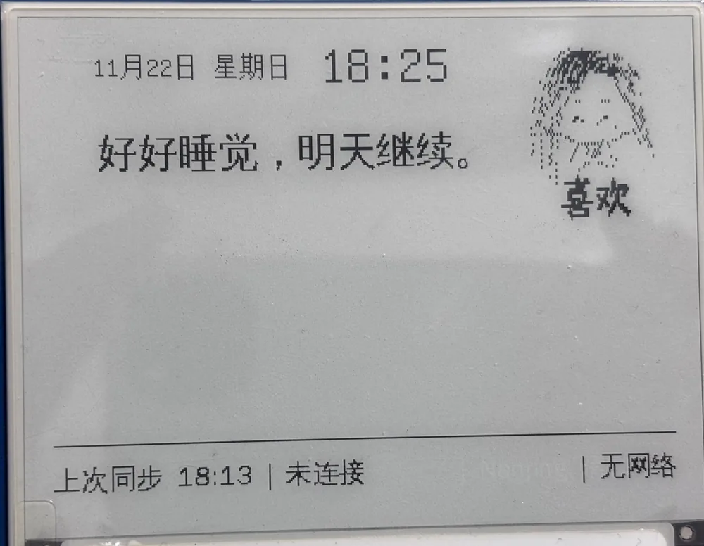

# 日励 · daily-spark

**Esp32c3 · Waveshare 4.2" 墨水屏**

日励（esp32-daily-spark）是一块 ESP32-C3 + 微雪 4.2 寸墨水屏（SSD1683，400×300）做的桌面时钟：联网校时、每天一句、右上角一张像素人物小画，底部显示 WiFi 状态和当地天气。所有配置都在手机网页上完成，换句子不需要重新烧录。



> 实际设备拍摄。拍照时临时断网，所以底栏显示「未连接 / 无网络」。

## 功能

- **网络校时**：开机后连接 WiFi 并做 SNTP 校时，之后每 24 小时同步一次；断网时继续使用掉电前保留的时间。
- **每日一句**：首次开机写入 30 句默认内容，之后由网页管理；每天 0 点换一句，一轮内不重复，也可以临时显示一句或把某句固定到屏幕上。
- **右上角人物画**：4 张 1 位像素图，默认每天随机换一张，也可以在网页上固定。
- **底部状态栏**：上次同步时间、WiFi 状态、天气和地点。WiFi 只显示 `SSID / 连接中 / 未连接` 三种状态。
- **稳定局部刷新**：分钟变化时只刷新时间区域，状态变化时只刷新底栏，不会闪整屏；跨天或换句时做一次全屏刷新清理残影。
- **手机配置网页**：WiFi 设置与扫描、句子管理、临时句子、固定句子、形象选择，保存后即时生效。

## 硬件

| 元件 | 说明                                   |
| ---- | -------------------------------------- |
| 主控 | ESP32-C3 Mini（4 MB Flash）            |
| 屏幕 | 微雪 4.2 寸墨水屏 V2，400×300，SSD1683 |
| 接线 | 见 [GPIO.md](GPIO.md)                  |

屏幕刷新瞬间电流较大，建议排线尽量短，并在 3V3 与 GND 之间并一颗 10 µF 以上的电容。

## 编译与烧录

需要 ESP-IDF v6.1。

```bash
# 按自己的安装方式加载 ESP-IDF 环境
source ~/.espressif/tools/activate_idf_v6.1.sh

idf.py set-target esp32c3
idf.py build
idf.py -p /dev/ttyACM0 flash monitor
```

`sdkconfig.defaults` 已配好 4 MB Flash、USB-JTAG 控制台和自定义分区表（192 KB NVS + 2.5 MB app）。串口设备按实际情况替换，例如 `/dev/ttyUSB0`。

## 第一次使用

1. 烧录后设备会广播一个开放热点 **`Daily-Spark`**，手机连上后打开 <http://192.168.4.1>。
2. 在「WiFi 连接」里扫描或手动填写家里的 2.4 GHz WiFi，保存后设备会自动连接并校时。
3. 配置网页一直在线。之后换了网络、密码填错，都可以重新连接 `Daily-Spark` 改回来。

> ESP32-C3 只支持 2.4 GHz。名字里带 5G 的网络不会出现在扫描列表里，手动填也连不上。

## 网页能做什么

- **WiFi 连接**：查看当前状态、扫描附近网络、保存新账号。名称不变时密码留空表示沿用原密码。
- **临时显示**：输入一句话立刻显示，不进入句子库，第二天自动恢复每日一句。
- **句子库**：最多 365 句、每句 60 字，可新增、修改、删除，或把某句固定到屏幕上（同样只在当天有效）。
- **右上角形象**：每日随机，或固定为「小曾曾 / 哈哈哈 / 无语 / 喜欢」中的一张。

句子库保存在 NVS 里，所以改句子不需要重新编译和烧录。

## 屏幕布局

```text
┌──────────────────────────────────────────────┐
│  11月22日 星期日    18:25      [像素小画]    │
│                                              │
│      好好睡觉，明天继续。                    │
│                                              │
│                                              │
│ ──────────────────────────────────────────── │
│  上次同步 18:13 | MyWiFi | Nanjing 晴 13°C   │
└──────────────────────────────────────────────┘
```

- 时间用 32 px 点阵，日期和底栏用 16 px，正文用 24 px。
- 正文自动换行，优先在逗号、句号后断行；前两行绕开右上角小画。
- 底栏天气格式是 `地点 天气 温度`，一行放不下时退成 `地点 温度`，再长就裁掉末尾。
- 断网时时间显示 `--:--` 或保留时间，底栏显示「未连接 / 无网络」。

## 天气

天气来自 [wttr.in](https://wttr.in)，按公网 IP 自动定位，取 `nearest_area[0].areaName` 作为地点，所以不需要手动填城市。联网时每 30 分钟更新一次，失败 5 分钟后重试。

## 现状与未来规划

| 内容       | 现状                                                                                                                                      | 未来规划                                                                                          |
| ---------- | ----------------------------------------------------------------------------------------------------------------------------------------- | ------------------------------------------------------------------------------------------------- |
| 句子库     | 首次开机把 `main/quotes.c` 里的 30 句默认内容写入 NVS；网页已经可以新增、修改、删除，最多 365 句、每句 60 字                              | 句子包导入/导出（纯文本或 JSON）、批量粘贴、一键恢复默认                                          |
| 右上角形象 | 4 张 1 位图编译进固件（`main/ansi_art.c`），由 `tools/gen_ansi_art.py` 从 ANSI 文本离线生成；网页只能选择或每日随机，新增要重新生成并烧录 | 在网页上传 ANSI 文本，设备端转成 1 位图并持久化；后续可扩展到常见图片格式，支持预览、重命名、删除 |

后续会做句库与形象画的自定义扩展。

## 说明

- 屏幕是 SSD1683（微雪 4.2inch e-Paper V2），工程只实现这一种控制器。
- 点阵字库覆盖 GB2312 一级、二级汉字和常用标点；生僻字、繁体、emoji 不在字库里，会留空。
- 字体由 GNU Unifont 和文泉驿正黑离线生成，生成脚本在 `tools/`；固件运行时不需要字体引擎。
